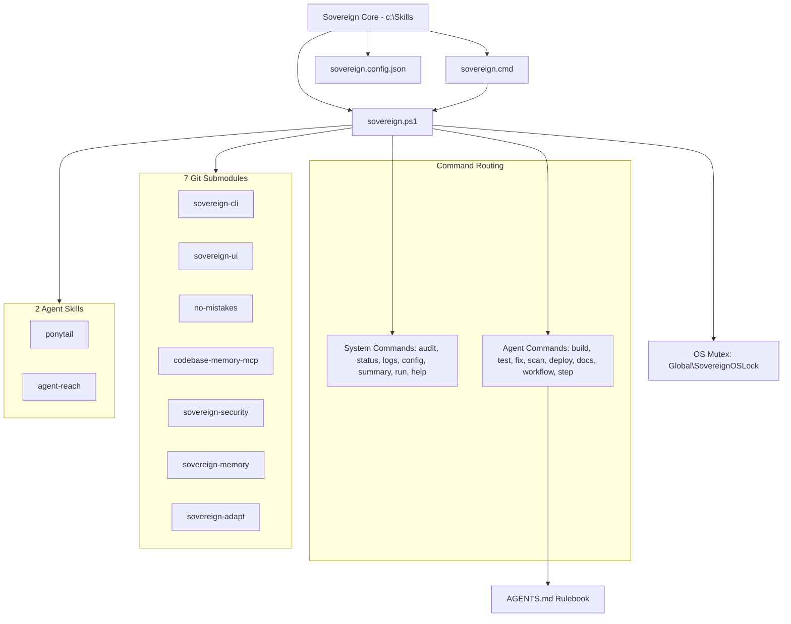

# Sovereign-OS V18 — Architecture Specification

## Overview

Sovereign-OS is a hyper-minimalist meta-framework designed to govern autonomous AI coding agents across projects. Built strictly on the **Ponytail Doctrine** (deletion before addition, zero unearned complexity, concrete utility over speculative features), it provides execution lock synchronization, dynamic asset management, and modular submodule structure.

---

## System Topology

---

## Core Components

### 1. PowerShell Orchestrator (`sovereign.ps1`)
- **Command Routing**: Uses `-Command` parameter to route commands natively. 
- **OS Mutex Lock**: Uses `System.Threading.Mutex` (`Global\SovereignOSLock`) wrapped in `try ... finally` to guarantee single-instance execution across processes.
- **Dynamic Discovery**: Scans `modules/` and `skills/` directories on every invocation and updates `sovereign.config.json` atomically.

### 2. Batch Wrapper (`sovereign.cmd`)
Provides the `sovereign <command>` shorthand for seamless command-line execution, forwarding calls directly to `sovereign.ps1`.

### 3. Command Dispatch
- **System Commands**: `audit`, `status`, `logs`, `config`, `summary`, `run`, `help` — Executed directly by the orchestrator.
- **Agent Commands**: `build`, `test`, `fix`, `scan`, `deploy`, `docs`, `workflow`, `step` — Handled by the AI agent per the `AGENTS.md` Rulebook.

### 4. Configuration Store (`sovereign.config.json`)
Atomic JSON configuration mapping system state, active submodules, enabled skills, and audit signatures.

### 5. Submodule Architecture (7 Modules)
Isolated Git submodules providing specialized capabilities:
- `sovereign-cli`: Go Cobra/Viper CLI
- `sovereign-ui`: Next.js App Router UI
- `no-mistakes`: Pipeline & PR Engine
- `codebase-memory-mcp`: Knowledge Graph MCP Server
- `sovereign-security`: Zero-Trust Secret Scanner
- `sovereign-memory`: Persistent Key-Value Ledger
- `sovereign-adapt`: Remediation & Tuning Engine
